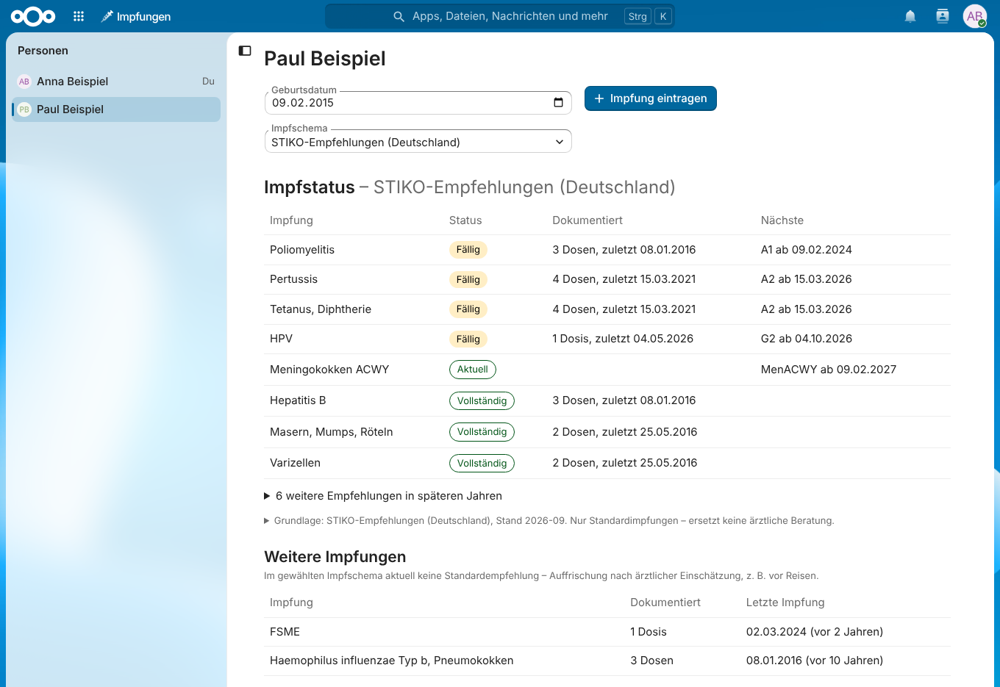

# Impfungen für Nextcloud

Eine Nextcloud-App, mit der du die Impfungen aller Personen deiner Nextcloud erfasst und gegen einen Impfkalender prüfst. Sie zeigt auf einen Blick, welche Impfungen überfällig sind, was demnächst ansteht und wie lange die letzte Impfung zurückliegt – auch für Kinder, die selbst keine Daten pflegen.



## Funktionen

- **Impfhistorie** pro Person: Datum, Impfstoff und optional Praxis, Chargennummer und Notiz. Die Impfstoff-Suche findet auch über Hersteller oder Krankheit („Masern“ → Priorix, M-M-RvaxPro …).
- **Impfstatus** gegen ein pro Person wählbares Impfschema: überfällig, fällig, demnächst (2 Monate vorher), aktuell, vollständig – mit Datum der nächsten Dosis.
  - **STIKO-Empfehlungen (Deutschland)**, Stand 2026-10 – inkl. FSME, sobald eine FSME-Impfung eingetragen ist
  - **Impfplan Österreich** 2026/27 (Version 1.1)
- **Ampel in der Personenliste**: rot bei überfälligen oder nicht dokumentierten Impfungen, gelb bei fälligen oder in den nächsten 2 Monaten anstehenden, grün wenn alles aktuell ist – der Tooltip nennt die Impfungen.
- **Weitere Impfungen** ohne Standardempfehlung (z. B. Reiseimpfungen) mit „vor X Jahren“.
- **Betreuer**: Eltern pflegen die Daten ihrer Kinder, die eigene Nextcloud-Konten haben. Jeder sieht nur sich selbst und die Personen, die er betreut.
- **Benachrichtigungen** in Nextcloud, wenn eine Impfung demnächst ansteht, fällig oder überfällig wird.
- **Offene Daten**: Impfstoffe, Krankheiten und Impfschemata liegen als JSON-Dateien im Repository und lassen sich per Pull-Request ergänzen.

> **Hinweis:** Die App ist eine Erinnerungshilfe und ersetzt keine ärztliche Beratung. Die Regeln sind vereinfacht abgebildet; Details und bekannte Vereinfachungen stehen in [`docs/STIKO-REGELN.md`](docs/STIKO-REGELN.md) und [`docs/IMPFPLAN-AT-REGELN.md`](docs/IMPFPLAN-AT-REGELN.md).

## Voraussetzungen

- Nextcloud 33, 34 oder 35
- PHP 8.2 oder neuer (Nextcloud 35: 8.3)
- Für Benachrichtigungen: die App **Notifications** (bei Nextcloud standardmäßig aktiv) und Hintergrundjobs per **Cron** (Einstellungen → Verwaltung → Grundeinstellungen)

## Installation

Die App ist nicht im Nextcloud App Store gelistet. Installiert wird sie aus dem fertigen Paket der [GitHub-Releases](https://github.com/derschneewolf/vaccinations/releases) – das enthält die gebaute Oberfläche, Node.js oder Composer werden auf dem Server nicht gebraucht.

### 1. Paket herunterladen

```sh
VERSION=0.5.1
curl -L -o vaccinations.tar.gz \
  "https://github.com/derschneewolf/vaccinations/releases/download/v$VERSION/vaccinations-$VERSION.tar.gz"
```

### 2. In den App-Ordner entpacken und aktivieren

Der Zielordner und der Aufruf von `occ` hängen davon ab, wie Nextcloud installiert ist. Das Archiv enthält den Ordner `vaccinations/`.

**Docker (offizielles `nextcloud`-Image)** – Container-Name ggf. anpassen:

```sh
docker cp vaccinations.tar.gz nextcloud:/tmp/
docker exec nextcloud sh -c "tar -xzf /tmp/vaccinations.tar.gz -C /var/www/html/custom_apps && chown -R www-data:www-data /var/www/html/custom_apps/vaccinations"
docker exec -u www-data nextcloud php occ app:enable vaccinations
```

**Snap (`nextcloud`-Snap)**:

```sh
sudo tar -xzf vaccinations.tar.gz -C /var/snap/nextcloud/current/nextcloud/extra-apps
sudo nextcloud.occ app:enable vaccinations
```

**Klassische Installation** (Nextcloud z. B. unter `/var/www/nextcloud`):

```sh
sudo tar -xzf vaccinations.tar.gz -C /var/www/nextcloud/apps
sudo chown -R www-data:www-data /var/www/nextcloud/apps/vaccinations
sudo -u www-data php /var/www/nextcloud/occ app:enable vaccinations
```

> Gibt es in `config/config.php` unter `apps_paths` einen eigenen beschreibbaren Ordner (meist `custom_apps`), gehört die App dorthin statt nach `apps`.

Danach erscheint oben in der Nextcloud der Menüpunkt **Impfungen**.

### 3. Betreuer zuordnen (optional)

Damit z. B. Eltern die Impfungen ihrer Kinder pflegen können:

```sh
occ vaccinations:guardian:add <betreuer> <person>     # z. B. frank kind
occ vaccinations:guardian:list
occ vaccinations:guardian:remove <betreuer> <person>
```

`occ` jeweils wie oben aufrufen (Docker: `docker exec -u www-data nextcloud php occ …`, Snap: `sudo nextcloud.occ …`). Administratoren sehen und pflegen ohnehin alle Personen.

## Update

Neues Paket herunterladen (wie unter [Installation](#1-paket-herunterladen), mit der neuen Versionsnummer), den alten Ordner `vaccinations` ersetzen und die Datenbank aktualisieren. Die erfassten Impfungen liegen in der Datenbank und bleiben erhalten.

**Docker:**

```sh
docker exec nextcloud rm -rf /var/www/html/custom_apps/vaccinations
docker cp vaccinations.tar.gz nextcloud:/tmp/
docker exec nextcloud sh -c "tar -xzf /tmp/vaccinations.tar.gz -C /var/www/html/custom_apps && chown -R www-data:www-data /var/www/html/custom_apps/vaccinations"
docker exec -u www-data nextcloud php occ upgrade
```

**Snap:**

```sh
sudo rm -rf /var/snap/nextcloud/current/nextcloud/extra-apps/vaccinations
sudo tar -xzf vaccinations.tar.gz -C /var/snap/nextcloud/current/nextcloud/extra-apps
sudo nextcloud.occ upgrade
```

**Klassische Installation:**

```sh
sudo rm -rf /var/www/nextcloud/apps/vaccinations
sudo tar -xzf vaccinations.tar.gz -C /var/www/nextcloud/apps
sudo chown -R www-data:www-data /var/www/nextcloud/apps/vaccinations
sudo -u www-data php /var/www/nextcloud/occ upgrade
```

Danach im Browser einmal **Strg + F5**, damit die neue Oberfläche geladen wird.

## Benutzung

- **Impfungen** im Menü öffnen, links die Person wählen, oben Geburtsdatum und Impfschema setzen.
- **Impfung eintragen** – am besten den Impfpass von neu nach alt abtippen.
- Impfungen, die gar nicht erfasst sind, erscheinen als **„nicht dokumentiert“** statt als überfällig; eine angefangene, unvollständige Serie gilt dagegen als echte Lücke.
- Benachrichtigungen kommen einmal täglich über den Hintergrundjob. Sofort prüfen: `occ vaccinations:notify`.

## Neue Version veröffentlichen

Version in `appinfo/info.xml` (und `package.json`) erhöhen und auf `main` pushen. Die GitHub-Action [`release.yml`](.github/workflows/release.yml) baut dann das Paket und legt das Release `v<version>` an.

## Mitmachen

- **Impfstoff fehlt?** Eine Datei unter [`data/vaccines/`](data/vaccines) anlegen – Vorlage ist jede vorhandene Datei, das Schema steht in [`data/schema/vaccine.schema.json`](data/schema/vaccine.schema.json). Die GitHub-Action prüft jeden Pull-Request automatisch.
- **Impfschema korrigieren oder ergänzen:** [`data/schedules/`](data/schedules), Aufbau in [`docs/ARCHITEKTUR.md`](docs/ARCHITEKTUR.md).
- **Entwicklung:** Eine fertige Entwicklungsumgebung mit Docker Compose liegt in [`dev/`](dev/README.md).

## Lizenz

[AGPL-3.0-or-later](LICENSE)
